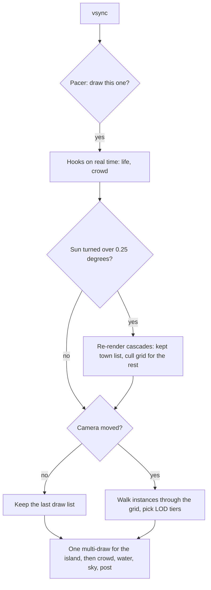

A Guildhall island is big. A 12,000-file repository becomes 2,813 land tiles and about 30,000 pieces: houses, trees, fences, crops, a castle. On top of that there is a crowd with daily routines, a sea with waves, a sky, and a sun that turns through the day and drags every shadow with it.

All of it runs in a browser tab, on WebGL, and I wanted it at 60 fps on my M1 Pro and smooth on a phone.

<Figure
  src="/images/blog/guildhall/guildhall-60fps-performance/island-12k.webp"
  alt="A 12,000-file hex island seen from above: thousands of houses, fields, rivers and roads, with an overlay reading 2813 land tiles and 30052 pieces"
  label="12,000 files"
  caption="A 12,000-file island from the Studio: 2,813 land tiles, 30,052 pieces. This is the heavy end of what has to stay smooth."
/>

This is the most technical part of the series. It is also the clearest case of the series' theme: experience defines the problem, the rules and the acceptance; AI executes fast.

**Performance is easy to claim and hard to prove.** And an idea that sounds like a sure win often isn't one.

## My list, and the rule above it

I came into the performance work with a list of ideas from experience: levels of detail, cached shadows, lighter far shadows, macro-shells for far clusters, taking the crowd out of the far shadows, culling tiny shadow casters, cheaper water in the distance.

Every item on it is a real technique. But a list is only a list of guesses. Some of those ideas would win, some would cost nothing, and some would quietly **change what you see**.

V1 of Guildhall had exactly that flaw: zoom in and out and the world visibly swapped. Things popped, and every distance had a slightly different look. So before any perf work started, I wrote a rule into the decisions file:

<Callout type="quote" author="decisions.md, 2026-10-12">
  Performance must not change what you see.
</Callout>

That one line made the work much harder, and much better. It meant a change only counted if it was **invisible**. To prove "invisible" you need numbers and pictures, not opinions. Including mine.

## Measure first: the contract

Before any optimisation, I wrote the contract and the plan. Then I handed the long measurement and implementation passes to a bigger model, Fable 5.1, running on that plan, and I decided what shipped. The contract reads more like a lab protocol than a task:

<ProcessFlow
  title="The perf contract, in five rules"
  steps={[
    {
      title: 'A fixed bench',
      description:
        'Six camera poses (hero, mid, wide, lanterns at 19:30, a busy noon square, low over the sea) at 4,000 and 12,000 files. Three runs each, nothing else running.',
    },
    {
      title: 'A ledger',
      description:
        'Every change appends before → after per pose. A change that gains less than the measured noise is reverted.',
    },
    {
      title: 'Invariants that block',
      description:
        'A look sheet (5 zooms × several hours, before vs after), a zoom sweep with no pops, shadows never stale or jumping.',
    },
    {
      title: 'One technique per commit',
      description: 'Each with its own numbers, so a win can be traced and a loss can be dropped.',
    },
    {
      title: 'A quiet machine, a real device, a human checkpoint',
      description:
        'No other browsers during a bench run; a check on a real phone; I see the ledger and the look sheets halfway; at the end, an agent that did not write the code reruns everything.',
    },
  ]}
/>

The first thing the measuring found was not a slow shader. It was the machine.

- **The Mac GPU timers lie.** `EXT_disjoint_timer_query_webgl2` on ANGLE over Metal read each command buffer's wall time, took 20–30 frames to resolve, and cost about 1.3 ms a frame on their own. So they became opt-in, and cost was measured **by subtraction**: load the page with a part switched off and compare.
- **One busy tab triples frame times.** A "quiet" bench read every pose at about 34 ms. My own Chrome had a live Guildhall tab open, and its GPU process was at 9–18% CPU. Closed, the same commit read 9.7 / 12.2 ms (p50 / p95). Nothing had regressed.
- **A phone beat the laptop.** On my Xiaomi the island ran above 60 fps while the Mac felt slower, because the agents' headless browsers were sharing its GPU. From then on, every bench run checked `ps` for other browsers and recorded it in the ledger.

This is the kind of rule experience gives you: **before you optimise the scene, isolate the machine.** Otherwise you are optimising noise.

## Where a frame actually goes

Here is the frame, as it ended up:



Each box in that diagram is a lesson. Let me go through them in the order they mattered.

## 1. BatchedMesh: count instances, not triangles

Every static piece on the island goes into one three.js `BatchedMesh`. All the geometries share one set of buffers, and the whole island is drawn with a single multi-draw call. A full frame is about 35 draw calls, which is also why WebGPU was not worth switching to yet: draw calls were never the bottleneck.

What _is_ the cost surprised me. On Metal, **the number of instances drives the batch's cost more than the triangle count.** Before every pass, three's `BatchedMesh` walks every instance: a frustum test, then the instance's geometry range goes into the draw list, and the list is uploaded to the GPU. With roughly 18,000 instances, that walk is the bill.

So I replaced the walk with my own (`LodBatchedMesh`), and the levers all work on instances:

- **LOD tiers live inside the same buffers.** The walk picks a tier's range instead of the full mesh. An instance between two tiers is listed twice, each copy with a dither code, so the switch is a crossfade in a band of 2 to 2.8 CSS pixels and never a pop.
- **Far clusters become one shell.** When a cluster (a house and its parts, a farmstead, a patch of forest) is far away, its parts are swapped for one shell instance. That cuts instances, which is what costs.
- **A still camera keeps its list.** If the camera's matrices, the canvas size and the instances did not change, the last draw list is still right. No walk, no upload.

The LOD is not decoration. Switching it off (`?lod=0`) makes the wide view 23–25 ms slower. But it only swaps where the difference is under about a pixel, and it fades.

## 2. Shadows that follow the sun without walking the island

The sun has three shadow cascades: a near one 30 m across at about 2.3 cm a texel, a middle one at 100 m, and one for the whole town. On a still camera none of them re-render. But the sun moves. Every time it turns a quarter of a degree, all three cascades are drawn again:

```ts
// sky.ts (simplified)
const SHADOW_TURN = (0.25 * Math.PI) / 180;

keyDir.set(...keyLight(current).dir);
if (keyDir.angleTo(shadowDir) > SHADOW_TURN) {
  shadowDir.copy(keyDir);
  preset.sun?.markDirty(); // re-render every cascade next frame
}
```

With the day running in the viewer, that is 30 cascade re-renders a second. The ledger put a number on it that I did not expect: **the day running cost the hero view about 30 fps** (85 → 56 on the laptop profile, 105 → 58 on the phone profile).

The cheap fix is a coarser turn: redraw shadows less often. That makes the shadows step visibly, so I said no. **Invisible fixes only.** Two rounds went into it:

- **Perf round 4: side passes get their own buffers.** Each shadow pass wrote into the same multi-draw buffers as the main view. So after any cascade re-render, the next frame walked all ~18k instances again and re-uploaded, _with the camera still_. Now shadow passes list into their own buffers and swap out after.
- **Perf round 5: keep the town cascade's list, and add a cull grid.** The town cascade's box holds the whole island from any sun angle, so its list is "every instance", whatever the sun does. It is now built once and kept until an instance changes. For the other passes, instances are binned into about 32 × 32 cells. A cell fully outside the frustum skips all its members, and a cell fully inside skips the sphere tests. The walk still goes in instance order, so the list is **the same list in the same order**, and a test proves it.

<StatBlock
  title="The day running: CPU side of the frame, p95 (CPU ×4 throttle)"
  stats={[
    { value: '22.4 → 19.8 ms', label: 'Laptop, own shadow buffers (round 4)' },
    { value: '19.3 → 16.2 ms', label: 'Laptop hero, kept list + cull grid (round 5)' },
    { value: '18.5 → 16.2 ms', label: 'Phone hero, round 5' },
    { value: '0.5 → ~0 ms', label: 'Town cascade walk, unthrottled' },
  ]}
/>

Across round 5, every day-running row dropped 2.3 to 3.4 ms of CPU p95. Fps rose 3–4 at the hero view. I also want to be honest about what this did _not_ do: a frame that turns the sun still draws three cascades on the GPU, so the wide view on the laptop profile did not move. The ledger says so in plain words.

## 3. Shader warm-up: the ANGLE/Metal link wait

The hitches were not where I expected either. Every frame over 25 ms traced to the same thing: **a shader program linking at its first use.**

When three.js draws an object for the first time, it builds its program and waits for the link in that frame. On ANGLE over Metal that wait is 30–50 ms for a typical program and up to hundreds of ms for the heavy ones. Worse, the parallel-compile extension reports a program as ready **before** Metal has finished. The wait then lands at the first synchronous call, whenever that is. I measured a 2 s grace period: still a 35 ms hitch. Waiting longer does not help.

So every program the world will ever need is linked under the loading cover: the shows (dragon, festival, comet), the weather (rain, snow, lightning), the skeletons, the lamps at dusk. The shows' programs are pinned so they are never dropped. And a subtle one: the batch's warm-up ran against an empty geometry with no normals, so it compiled a variant **nothing ever drew**. Now it warms with one-triangle stand-ins that carry the real attributes.

| 12k island, frames over 25 ms                   |        before |         after |
| ----------------------------------------------- | ------------: | ------------: |
| show start: dragon / festival / comet / rainbow | 2 / 2 / 1 / 1 | 0 / 0 / 0 / 0 |
| weather: rain / storm / snow                    |     1 / 1 / 1 |     0 / 0 / 0 |
| undead rise                                     |             1 |             0 |
| season change: winter                           |             0 |     1 (27 ms) |
| **total**                                       |        **10** |         **1** |

Shader programs compiled before the reveal also went from **40 to 32**. The post passes had been compiled twice, once against the scene with fog and once in their own quad scene.

## 4. Workers, and a buffer that copied itself

The world is built in a worker. In perf round 2, the life plan (who lives where, who walks which road, at what hour) moved into a worker too. The plan is the same plan byte for byte, and a test proves it.

| Longest main-thread task after the first frame | 4,000 files | 12,000 files |
| ---------------------------------------------- | ----------: | -----------: |
| Life planned on the main thread                |    1,999 ms |     3,767 ms |
| Life planned in the worker                     |      323 ms |       495 ms |

Then a 2.4 s stall remained that was neither CPU work nor shader compiling. The traces showed it: the batch was drawn while its geometry was still being copied in slices. Each `bufferSubData` into a buffer the previous frame was still drawing made ANGLE/Metal **copy the whole 130 MB buffer again**. The fix was almost boring: keep the batch hidden until every geometry is in, then upload once. The batch built in 1.1–1.4 s instead of 4.8–5.1, and the whole island in 4.5 s instead of 10.5.

That one was on nobody's list, mine included. It came from reading the trace and asking why a GL call would wait on a GPU that had nothing to do.

## 5. Gzipped GLBs with DecompressionStream

Vercel compresses text, JSON and JS, but sends a `.glb` as it is. The character rig alone was 3.14 MB. So the build ships every library GLB gzipped, and the page inflates it with the browser's own `DecompressionStream`:

```ts
// gltf.ts (simplified)
export const isGzip = (bytes: Uint8Array) =>
  bytes.length > 2 && bytes[0] === 0x1f && bytes[1] === 0x8b;

export async function inflateIfGzip(bytes: Uint8Array) {
  if (!isGzip(bytes)) return bytes;
  const stream = new Blob([bytes]).stream().pipeThrough(new DecompressionStream('gzip'));
  return new Uint8Array(await new Response(stream).arrayBuffer());
}
```

The bytes decide, not the file name. A host that already decoded the gzip, a plain `.glb` from the dev server, or a CDN of either kind all read the same.

<StatBlock
  title="First load of a town, on the wire"
  stats={[
    { value: '9.25 → 5.24 MB', label: 'Total transferred' },
    { value: '7.89 → 4.02 MB', label: 'GLB models' },
    { value: '3.14 → 0.86 MB', label: 'The character rig' },
    { value: '412 → 311', label: 'Requests (data bundled)' },
  ]}
/>

## 6. The final pass: small things that add up

The last pass of round 2 was a set of small, separate commits, each measured on its own:

- **Dark lamps are free.** By day, the 8 lamp lights cost 1.2–3.6 ms a frame for nothing. The fragment shader now skips a light that is off.
- **One shared palette material per object kind**, so three does not switch programs between meshes, instanced meshes and the batch.
- **No double anti-aliasing.** The canvas had MSAA while the post pipeline already ran SMAA on its own target.
- **Less garbage** in the per-frame code.

| Uncapped, 4,000 files, p50 / p95 (ms) |      before |      after |
| ------------------------------------- | ----------: | ---------: |
| hero                                  |  8.9 / 11.7 |  6.3 / 8.1 |
| wide                                  | 10.6 / 13.6 | 8.0 / 10.9 |
| lanterns (19:30)                      |  8.1 / 11.6 |  7.3 / 8.3 |
| busy noon square                      |   6.7 / 9.0 |  4.2 / 6.0 |
| low over the sea                      |  9.9 / 14.0 | 8.5 / 10.4 |
| hero, 12,000 files                    |  9.0 / 12.4 |  6.3 / 8.3 |

Frames dropped by roughly 25–35%. Same pictures.

## 7. Never a blank screen, and a faster reveal

Perf round 3 was about the first seconds. Before, opening a town showed a bare pale canvas under the Studio chrome for a moment. Now an inline boot cover paints from the very first frame, then fades into the world's own cover. A scan of every captured frame finds no blank frame after first paint.

<Figure
  src="/images/blog/guildhall/guildhall-60fps-performance/boot-504ms-before-after.webp"
  alt="Two screenshots of the same page at 504 ms after navigation: on the left a blank pale canvas under the top bar, on the right a dark cover with the Guildhall crest and a list of loading stages"
  label="504 ms after navigation"
  caption="The same moment, before and after. Left: a bare canvas. Right: the boot cover, with the loading stages (Map, Ground, Pieces, Water, Townsfolk, Light)."
/>

Behind the cover, the life worker now rebuilds the island on its own and starts planning at about 1 s, so the plan lands while the batch is still building, not after it. Measured as cold loads with vsync on, median of three:

<StatBlock
  title="Time until the world is revealed"
  stats={[
    { value: '4.9 → 3.7 s', label: '4,000-file town' },
    { value: '7.1 → 5.1 s', label: '12,000-file town' },
    { value: '8.0 → 6.6 s', label: "React's repository" },
    { value: '2,029 → ~230 ms', label: "Longest task under React's cover" },
  ]}
/>

600 ms of every reveal is the cover's own fade. I left it, because the fade is part of the moment.

## 8. Pacing first, then the quality ladder

The last idea is about what "smooth" means. A frame rate jumping between 60, 40 and 30 feels worse than a steady 30. So pacing comes **before** any quality drop.

The stage draws on every n-th vsync. Skipped vsyncs draw nothing and run no hook, and every animation runs on real elapsed time, so nothing slows down at 30:

```ts
// pace.ts (simplified)
export const PACE_MS = 33.3; // the ~30 fps cadence

/** The vsync divisor that paces a display at ~30 fps: 2 on 60 Hz, 4 on 120 Hz. */
export function divisorFor(vsyncMs: number): number {
  if (!(vsyncMs > 0) || vsyncMs >= PACE_MS * 0.75) return 1;
  return Math.max(2, Math.round(PACE_MS / vsyncMs));
}
```

Auto mode steps down after two bad seconds in a row, and steps back up only after eight calm ones. If a raise does not hold, the next wait doubles, so it never flaps. In Settings → Motion you can pick Auto, Smooth 30 or Max.

On an emulated phone (390 × 844, DPR 3, CPU slowed ×6), the frames went from **33.4 / 41.0 ms** (p50 / p95) to **16.7 / 18.4 ms**: a steady 60 on a 120 Hz panel.

Only when even the 30 cadence cannot hold does the quality ladder step down, one rung at a time:

```ts
// governor.ts: the tiers, full quality first
export const TIERS = [
  { dprFloor: 1.5, shadowMap: 2048, lodBias: 1, particles: 256 },
  { dprFloor: 1, shadowMap: 2048, lodBias: 1, particles: 256 },
  { dprFloor: 1, shadowMap: 1024, lodBias: 1.6, particles: 128 },
  { dprFloor: 0.75, shadowMap: 1024, lodBias: 2.5, particles: 64 },
];
```

Phones start one tier down, weak GPUs two, and Auto climbs back to the full look after 20 calm seconds. On my M1 the tiers barely move the frame (the island is GPU-bound there whatever the shadow resolution), which is exactly why the ladder sits behind pacing and not in front of it.

<Gallery
  title="The quality ladder, tier 0 to 3"
  columns={2}
  images={[
    {
      src: '/images/blog/guildhall/guildhall-60fps-performance/tier-0.webp',
      alt: 'The 4,000-file town at tier 0, full quality',
      caption: 'Tier 0: the full look',
    },
    {
      src: '/images/blog/guildhall/guildhall-60fps-performance/tier-1.webp',
      alt: 'The same town at tier 1',
      caption: 'Tier 1: lower resolution floor',
    },
    {
      src: '/images/blog/guildhall/guildhall-60fps-performance/tier-2.webp',
      alt: 'The same town at tier 2',
      caption: 'Tier 2: 1024 shadow maps, closer crowd LOD, fewer particles',
    },
    {
      src: '/images/blog/guildhall/guildhall-60fps-performance/tier-3.webp',
      alt: 'The same town at tier 3',
      caption: 'Tier 3: the lowest rung',
    },
  ]}
/>

## The acceptance test: byte-identical pictures

Every round ended the same way. A **look sheet**: the same island, the same frozen clock, 5 zoom levels at noon, 16:30 and 19:30, captured before and after, and diffed pixel by pixel.

For round 3, all 15 shots matched with a mean difference of **0.000/255**: byte for byte. In rounds 4 and 5 the only differences were one flat piece at the closest zoom that comes and goes between two captures of the _same_ build, before any change. A moving-sun strip of 48 frames was byte-identical too.

<Gallery
  title="Look sheet, perf round 3 (after); the diff against before is black"
  columns={3}
  images={[
    {
      src: '/images/blog/guildhall/guildhall-60fps-performance/look-h12-z0.5.webp',
      alt: 'The town at noon, closest zoom',
      caption: '12:00, closest zoom',
    },
    {
      src: '/images/blog/guildhall/guildhall-60fps-performance/look-h12-z2.3.webp',
      alt: 'The island at noon, mid zoom',
      caption: '12:00, zoom ×2.3',
    },
    {
      src: '/images/blog/guildhall/guildhall-60fps-performance/look-h12-z5.webp',
      alt: 'The whole island in a blue sea at noon',
      caption: '12:00, zoom ×5',
    },
    {
      src: '/images/blog/guildhall/guildhall-60fps-performance/look-h16.5-z1.webp',
      alt: 'The castle and the town in late afternoon light with long shadows',
      caption: '16:30, zoom ×1',
    },
    {
      src: '/images/blog/guildhall/guildhall-60fps-performance/look-diff-h16.5-z1.webp',
      alt: 'A completely black image: the pixel difference between before and after',
      caption: 'The diff of 16:30 ×1: zero everywhere',
    },
    {
      src: '/images/blog/guildhall/guildhall-60fps-performance/look-h19.5-z0.5.webp',
      alt: 'The town at dusk with lamps and windows lit',
      caption: '19:30, closest zoom',
    },
  ]}
/>

That is the bar: **if the picture moved, the optimisation did not ship.**

## What I measured and dropped

The honest negatives are the part of the ledgers I like most. These were my own ideas, most of them from my list for round 4, and each one sounded like a sure win. The measurements said otherwise:

| Idea                                               | What the measurement said                                                                                                                                                                 | Verdict       |
| -------------------------------------------------- | ----------------------------------------------------------------------------------------------------------------------------------------------------------------------------------------- | ------------- |
| Cull shadow casters smaller than a texel           | Nothing is sub-texel where shadows cost: in the town cascade, 11 of 10,632 instances are under one texel (0.03% of shadow triangles). At two texels a visible dot of shadow would vanish. | not built     |
| Take the crowd out of the far cascades             | Already so: the crowd never casts into any cascade. Their shadows are contact blobs.                                                                                                      | nothing to do |
| Skip the water under the island; cheaper far water | Built and measured twice: wide 8.2 → 8.2 ms, hero 6.7 → 6.7. Water under the land already fails the depth test. A real far-water saving would fade the waves earlier: a look change.      | dropped       |
| Lighter far-cascade softening                      | The softness is the spacing of a fixed 3×3 kernel, not its tap count. Same nine taps, same cost.                                                                                          | not built     |
| Spread cascade re-renders across frames            | A stale cascade would blend with a fresh one for a frame. Visible.                                                                                                                        | not built     |
| Redraw shadows less often as the sun turns         | Shadows would step. Replaced by the kept list and the cull grid.                                                                                                                          | rejected      |

And one thing I accepted: a 12,000-file island seen from the widest view is still heavy on the laptop profile. The levers left there all touch the look. My note in the decisions file: _"12k is too big and crazy."_ The demo-size islands are smooth, and I would rather say that than ship a blurrier kingdom.

## The lesson

AI did nearly all of the typing here. I wrote the contract and the plan, delegated the long measurement and implementation passes, and decided what shipped. The execution was fast because the rules were clear. The parts that came from experience:

- the rule that perf must be invisible, written before the first commit;
- isolating the machine before trusting a single number;
- reading a trace and asking why a buffer copy would wait on an idle GPU;
- letting the look sheet overrule my own ideas when it said no.

Ideas are cheap, mine included. **The job is to know which ones your scene actually pays for, and to prove the rest away.**

Next in the series, the finale: **React and TypeScript for a 3D world**, and how one codebase keeps a game engine and a React app from fighting each other.

The kingdom runs at [guildhall.codestz.dev](https://guildhall.codestz.dev) (try it on your phone, and Settings → Motion), and the code, ledgers included, is on [GitHub](https://github.com/Codestz/guildhall).
