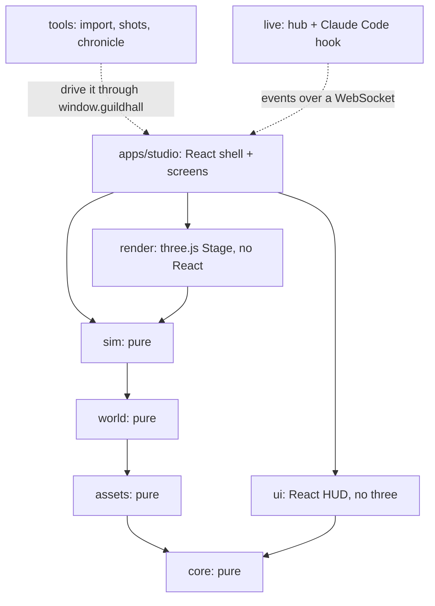

Open [Guildhall](https://guildhall.codestz.dev) and it looks like a small strategy game. There's a castle, a town, a crowd with daily routines, heroes walking out on quests, and weather.

Under the hood it's a React and TypeScript app, built with Vite and tested with Bun. **There is a game engine hiding inside it, and most of this post is about how the two are kept from fighting.**

<Figure
  src="/images/blog/guildhall/guildhall-react-typescript-3d/hero.webp"
  alt="Guildhall's castle at golden hour, with a dark HUD on top: a brand plate and portraits top left, name chips over the heroes, a chronicle list bottom left and a caption at the bottom"
  label="Two worlds, one frame"
  caption="Everything with a dark plate is React. Everything behind it is three.js. They never share a render."
/>

In the earlier parts I wrote about the hard problems: the Studio, procedural generation, collisions, animation, frame rate. This one is about the structure that held all of them up. It's the least glamorous part of the project and the one I'm most sure about, because it comes straight from experience and not from a prompt.

## Two clocks that must not meet

A 3D scene and a React tree run on different clocks.

The scene draws every vsync, 60 times a second or more. Every frame the camera eases, a few hundred people take a step, the sun moves, the water moves. React works differently. Something changes, it reconciles a tree, it commits to the DOM. That's great for a settings panel and a terrible way to move 18,000 pieces 60 times a second.

So the first architecture decision (ADR 001, written as the V2 skeleton was laid) was blunt:

<Callout type="quote" author="ADR 001, Layers, where three-dependent code lives, React DOM shell">
  Apps are a React DOM shell that mounts render's Stage into a div. No R3F: the vanilla core owns
  the frame loop, and R3F's loop and reconciler would fight it.
</Callout>

`packages/render` owns every three.js object. Its `Stage` is a plain object with its own `requestAnimationFrame` loop. Here is the heart of it (simplified from `stage.ts`):

```ts
const frame = (now: number) => {
  raf = requestAnimationFrame(frame);
  // a skipped vsync: nothing drawn, no hook run, no GPU work
  const every = Math.max(divisor, throttle);
  if (every > 1 && vsyncs % every !== 0) return;
  const ms = last === null ? 0 : now - last;
  last = now;
  if (holds > 0) return; // a loading cover is up: draw nothing
  rig.update(ms / 1000); // the camera moves first
  for (const fn of frameFns) fn(ms / 1000); // crowd, sea, sky, chips...
  if (draw)
    draw(); // the post pipeline
  else renderer.render(scene, camera);
};
```

No hooks, no state, no props. Modules subscribe with `stage.onFrame(fn)` and get back an unsubscribe function.

React only mounts it. The shell finds the screen the URL names, hands it a `<div>`, and keeps the teardown:

```tsx
useEffect(() => {
  const target = screenFor(id);
  const dispose = target.mount(host.current, {
    query: params,
    attach: debug.attach, // the stage goes to the HUD and window.guildhall
    load: debug.load, // async work that guildhall.ready() waits for
  });
  return () => {
    dispose();
    debug.attach(null);
  };
}, [key, debug]);
```

That's the whole contract between React and the engine: **mount, attach, dispose.**

<DecisionLog
  title="ADR 001: the choices around the shell"
  decisions={[
    {
      proposal: 'React Three Fiber for the whole app',
      verdict: 'rejected',
      reasoning:
        'Two render loops. The vanilla core owns the frame; R3F can come back later only with a new ADR and a real need.',
    },
    {
      proposal: 'Vanilla three.js in packages/render, React DOM only as shell and HUD',
      verdict: 'accepted',
      reasoning:
        'One owner of the frame loop, and the lower layers stay pure so they can run in workers and tests.',
    },
    {
      proposal: 'dependency-cruiser to enforce the layers',
      verdict: 'rejected',
      reasoning: 'One more tool and config language for a rule a short Bun test already enforces.',
    },
    {
      proposal: 'The layer rule as a Bun test (test/layers.test.ts)',
      verdict: 'accepted',
      reasoning:
        'It checks source imports and package.json dependencies with the same rules, and runs with every other test.',
    },
  ]}
/>

## Layers that only point down

The monorepo is Bun workspaces: `packages/*`, `apps/*`, `tools/*` and `live/*`.

<FileTree
  items={[
    {
      id: 'root',
      name: 'guildhall/',
      type: 'folder',
      children: [
        {
          id: 'packages',
          name: 'packages/',
          type: 'folder',
          children: [
            { id: 'core', name: 'core/  types, hash, events, logger, debug API', type: 'file' },
            { id: 'assets', name: 'assets/  catalog, palette, scale (pure data)', type: 'file' },
            {
              id: 'world',
              name: 'world/  hex island, sites, roads, life, collisions',
              type: 'file',
            },
            { id: 'sim', name: 'sim/  events, guild, roster, stories, director', type: 'file' },
            { id: 'render', name: 'render/  three.js: stage, crowd, sea, sky, post', type: 'file' },
            { id: 'ui', name: 'ui/  React HUD and Viewer chrome', type: 'file' },
          ],
        },
        {
          id: 'apps',
          name: 'apps/',
          type: 'folder',
          children: [
            { id: 'studio', name: 'studio/  the site + the Studio (Vite, React 19)', type: 'file' },
          ],
        },
        {
          id: 'tools',
          name: 'tools/',
          type: 'folder',
          children: [
            {
              id: 'import',
              name: 'import/  asset packs to catalog (gltf-transform)',
              type: 'file',
            },
            { id: 'shots', name: 'shots/  headless screenshots + perf', type: 'file' },
            {
              id: 'chronicle',
              name: "chronicle/  a repo's git history to a chronicle",
              type: 'file',
            },
            { id: 'palette', name: 'palette/  colour extraction', type: 'file' },
          ],
        },
        {
          id: 'live',
          name: 'live/',
          type: 'folder',
          children: [
            { id: 'hub', name: 'hub/  local WebSocket hub', type: 'file' },
            { id: 'cc', name: 'claude-code/  the hook Claude Code runs', type: 'file' },
            { id: 'lcore', name: 'core/ + roster/  wire format, roles, ranks', type: 'file' },
          ],
        },
        { id: 'test', name: 'test/layers.test.ts', type: 'file' },
      ],
    },
  ]}
/>

The order is `core < assets < world < sim < render`. A layer may import only the ones before it. `ui` sits beside render and may never touch three.js. Apps may never import `three` directly. Render is the only door.



The four bottom layers are **pure**: no three, no React, no `node:*`. That one rule pays three times. They run in a Web Worker. They run in `bun test` with no browser. And an agent working in `world` can't accidentally reach for the renderer, because the test fails.

This is what the stage looked like on day zero of V2, before any world existed: a capsule, three boxes, and the perf HUD reading the stage's own numbers.

<Figure
  src="/images/blog/guildhall/guildhall-react-typescript-3d/m0-skeleton.webp"
  alt="A flat grid with a grey capsule and three coloured boxes, and a small dark PERF panel listing fps, frame p50 and p95, draw calls, triangles, geometries, textures and dpr"
  label="Milestone 0"
  caption="The skeleton milestone: layers, the stage, the logger, the debug API, the shot harness and the perf HUD, before a single tree."
/>

## The world is a function of a seed

Every "random" choice in Guildhall is a hash. `core/hash.ts` is FNV-1a, and `roll(seed, salt)` turns a seed and a name for the choice into a number between 0 and 1. There's no `Math.random()` in the world. That means the same seed and the same repo size give the same island, on my laptop, on your phone, and in a test:

```ts
test('same seed, same island', () => {
  const a = hexIsland({ seed: 4 });
  const b = hexIsland({ seed: 4 });
  expect([...a.kind]).toEqual([...b.kind]);
  expect([...a.level]).toEqual([...b.level]);
});
```

Because the generators are pure, they can move off the main thread. The island screen starts a worker that runs the whole build (`hexIsland`, `hexZones`, `hexWorld`, the ground mesh, the placed pieces, the shore field, everyone's day plan). It posts the results back in stages as typed arrays, handed over and not copied. The main thread only uploads. The same worker then stays around to plan new heroes as a session's log grows.

And because the world is a function of its inputs, **a URL is a full repro.** These are six real URLs on the live site, taken for this post:

<Gallery
  title="One island, six URLs"
  columns={3}
  images={[
    {
      src: '/images/blog/guildhall/guildhall-react-typescript-3d/town7.webp',
      alt: 'Island VII, seed 7, a town with a castle, rivers and autumn trees',
      caption: '/town/7: seed 7, a 4,000-file repo',
    },
    {
      src: '/images/blog/guildhall/guildhall-react-typescript-3d/town8.webp',
      alt: 'Island VIII, a different layout with the castle at the top left and a river on the right',
      caption: '/town/8: one more seed, a different island',
    },
    {
      src: '/images/blog/guildhall/guildhall-react-typescript-3d/town7-winter.webp',
      alt: 'The same Island VII covered in snow, same houses in the same places',
      caption: '?season=winter: the same island, same houses',
    },
    {
      src: '/images/blog/guildhall/guildhall-react-typescript-3d/town7-big.webp',
      alt: 'Island VII grown for 12,000 files: a bigger castle and more buildings',
      caption: '?files=12000: the same seed, grown for a bigger repo',
    },
    {
      src: '/images/blog/guildhall/guildhall-react-typescript-3d/town7-collide.webp',
      alt: 'Island VII with the collision layer drawn on top: red outlines round every building and wall, dots for activity spots',
      caption: '?collide=1: the collision layer over the same frame',
    },
    {
      src: '/images/blog/guildhall/guildhall-react-typescript-3d/town7-perf.webp',
      alt: 'Island VII with a PERF panel listing cost, CPU per system, draw calls, triangles and dpr',
      caption: '?hud=perf&dev=1: the perf HUD, a dev-only parameter',
    },
  ]}
/>

## How the HUD listens without re-rendering 60 times a second

The HUD still has to show live things: the clock, who's working where, the timeline, the frame rate. The rule is simple. **The sim pushes, React picks a slice, and React only re-renders when its slice changes.**

On the sim side, the guild's world is a reducer. `reduce` in `sim/events/reduce.ts` is pure and immutable, and it reads no clock but the event's own timestamp. So the world at time `t` is just the log folded up to `t`, whether it's playing live or being scrubbed. Selectors next to it (`select.ts`) turn that world into what the HUD reads.

On the React side there's a tiny store and one hook, built on `useSyncExternalStore`:

```ts
/** One slice of the state: the component re-renders only when the slice changes. */
export function useSlice<T>(store: Store, pick: (s: ViewState) => T): T {
  return useSyncExternalStore(store.subscribe, () => pick(store.get()));
}
```

Where a value changes every frame, the slice gets coarser on purpose. The history bar subscribes to the clock through a key that, while it plays, only changes when the rate or a jump changes. It doesn't change with every tick of time:

```ts
useSyncExternalStore(clock.subscribe, () => barKey(clock.get()));

// playing: re-render only on a rate change or a jump; at rest: on the time too
const barKey = (s) =>
  s.playing ? `play|${s.rate}|${s.jumps}` : `rest|${s.rate}|${s.jumps}|${s.t}`;
```

And the things that really do move every frame, the name chips floating over the heroes' heads, aren't React at all. They're plain DOM that the screen writes directly, with a declutter pass about ten times a second. The comment at the top of `chip.ts` says it outright: _no React per frame_.

<Figure
  src="/images/blog/guildhall/guildhall-react-typescript-3d/town7-inspector.webp"
  alt="Island VII with the Inspector open on the right: build figures (seed, repo files, land tiles, pieces placed, build times) and sliders for seed, repo files, coast shape, hill levels and rivers"
  label="The Inspector"
  caption="The Viewer's Inspector is React, over a stage React never touches. Its knobs live in the URL, so moving a slider is the same as sharing a link."
/>

## One registry for every URL parameter

When everything is reproducible from a URL, the URL becomes an API, and an API needs a contract. Near the end, query parameters had spread across the codebase. The fix was one typed registry, `apps/studio/src/params.ts`:

```ts
export const PARAMS = {
  season: pub('any', 'A pinned season (spring, summer, autumn, winter)', text),
  files: pub('any', "The island's size, as a repo of that many files", num),
  collide: pub('studio', 'The collision layer overlay (knob)', one),
  hud: dev('any', '=perf: the perf HUD from the first frame (tools/shots)', text, true),
  // ...
};

const files = param(query, 'files'); // number | null: the parser's return type
```

(Simplified: the real descriptions are longer.) There are 86 parameters: 56 public ones that the site's links and Settings write, and 30 dev ones for shots, tests and perf tools. The dev ones only work on localhost or with `?dev=1`, and anywhere else they're silently ignored. **A test fails if any code reads a parameter that isn't declared here.** The share card builds its link from `publicOnly(query)`, so a debug flag never leaks into a link someone posts.

## `window.guildhall`: a door for tools and agents

Part 1 was about giving the AI eyes. This is the hinge that made it possible. Every page exposes a small typed debug API, declared in `core/debug.ts`: `ready()`, `camera.get/set`, `perf.now/sample`, `open(link)`, and an `ext` bag that screens fill with their own handles (the clock, the season, the life sim, the session, the FX, about thirty in all).

`ready()` waits until every tracked load has settled and two more frames have been drawn. So a script never shoots a half-built island. A real shot script then drives the world like this (simplified from `tools/shots/living.ts`):

```ts
await page.evaluate(() => window.guildhall.ready());
await page.evaluate((ms) => {
  const s = window.guildhall.ext.session;
  s.clock.seek(s.clock.get().end - ms, { jump: true });
  s.clock.play(true);
}, before);
await page.evaluate((who) => window.guildhall.ext.camera.follow(who), heroId);
await page.screenshot({ path: out });
```

The shots in this post were taken that way against the live site. So were the before/after sheets the agents had to look at before they could report a task as done.

## Every screen is its own chunk

The site and the Studio are one app with fifteen screens: the island, the demos, the harbour, How it's built, a repo's hall, and the Studio's tools. Each screen registers in one line and loads lazily:

```ts
lazy("composer", "Tile composer", () => import("./composer/index.tsx").then((m) => m.composer)),
```

The import goes through `ctx.load`, so `guildhall.ready()` waits for it too. When I asked whether to split the Studio into its own site, the measurement said there was no need: the first load is the main chunk at 20 KB plus the shell and React at 126 KB gzipped, and each Studio tool is a 7 to 10 KB chunk that's fetched only when you open it.

<Gallery
  title="Fifteen screens, one shell"
  columns={3}
  images={[
    {
      src: '/images/blog/guildhall/guildhall-react-typescript-3d/s-built.webp',
      alt: 'The How it is built page: a title reading A repository, grown into an island, figures and a list of eight chapters',
      caption: "/built: How it's built",
    },
    {
      src: '/images/blog/guildhall/guildhall-react-typescript-3d/s-studio.webp',
      alt: 'The Studio home: Guildhall Studio title, a live canteen tile, and counts of pieces, packs, tile prefabs, activity spots and clips',
      caption: "/studio: the workshop's front door",
    },
    {
      src: '/images/blog/guildhall/guildhall-react-typescript-3d/s-pieces.webp',
      alt: 'The Pieces browser: a grid of weapons and characters, pack filters on the left, a character silhouette for scale on the right',
      caption: '/pieces: 1,568 pieces in 19 packs',
    },
    {
      src: '/images/blog/guildhall/guildhall-react-typescript-3d/s-composer.webp',
      alt: 'The Tile composer with a tavern tile, coloured rings for its spots and a list of pieces and blockers',
      caption: '/composer: a tile prefab as data',
    },
    {
      src: '/images/blog/guildhall/guildhall-react-typescript-3d/s-npcs.webp',
      alt: 'The NPC builder: a row of eight farmers in different outfits and a close-up of one',
      caption: '/npcs: eight farmers from one recipe',
    },
    {
      src: '/images/blog/guildhall/guildhall-react-typescript-3d/s-hexmap.webp',
      alt: 'The Hex map: a 2D hex island with labelled places, and an Inspector with summary figures and knobs',
      caption: '/lab/hexmap: the same generator in 2D',
    },
  ]}
/>

The React side also adapts by itself. On a phone the same HUD collapses into a menu, a caption and a face bar, and the engine underneath doesn't know or care.

<Figure
  src="/images/blog/guildhall/guildhall-react-typescript-3d/phone.webp"
  alt="Guildhall on a phone: the castle close up with a Guildmaster chip, a caption reading The Guildmaster sends the Artisan, the Artisan II and the Archivist out at once, and a row of hero portraits"
  label="On a phone"
  caption="The same stage, a compact HUD. Only the React layer changes shape."
/>

## Why strictness made the agents fast

This is the part that ties back to the theme of the series.

Guildhall was built with a lot of agents. One conductor session talked with me, kept `decisions.md`, wrote the task briefs, merged the work and ran the checks. Workers ran in parallel git worktrees, one task each: speed, crowd, prefabs, nature, collisions, procedural sites, scenes, the UI system, atmosphere. Every brief was a contract: what to read, which files it owned, what it must not touch, how it would be accepted, and what to report, including what it didn't achieve.

That only works if the codebase can **say no** without me in the room. Here's what said no:

<StatBlock
  title="The guard rails, measured today"
  stats={[
    { value: '2,405', label: 'Tests across 225 files (bun test)' },
    { value: '9.35M', label: 'expect() calls: seed sweeps, not examples' },
    { value: '15', label: 'TypeScript projects (tsc -b)' },
    { value: '86', label: 'URL params in one typed registry' },
  ]}
/>

- **TypeScript at its strictest:** `strict`, `noUncheckedIndexedAccess`, `verbatimModuleSyntax`, `noImplicitOverride`, and project references, so each package type-checks as its own unit. A worker that changes a type in `world` sees every broken caller before it reports.
- **Pure, deterministic modules.** A pure function with a seed is the easiest thing in the world to test, and the easiest thing for an agent to reason about. The world tests don't check one example. They sweep seeds and sizes: no building over water, nobody standing inside a wall.
- **The layer test.** An agent can't "just import three" in the sim to fix something quickly.
- **Biome** for lint and format, and one command, `bun run check` (lint, typecheck, test), as every brief's acceptance.

None of that is new. It's what I'd ask of any team I've worked on. The difference is what it buys with agents. A strict compiler and a fast suite are a reviewer that works at the agents' speed. Without them I'd have been the bottleneck, reading every diff. With them I could read reports and look at contact sheets.

The rules didn't all exist on day one. Each failure became one. An agent stopped processes by name and killed every dev server on my machine, including mine. The rule after that: stop only your own port or PID. Two agents edited the same island screen. The rule after that: name the owner of each file in the brief, keep shared files to wiring-only edits, and rebase before reporting.

<Callout type="tip">
  If you want many agents in one codebase, make the codebase able to refuse bad work on its own:
  strict types, pure modules, a fast suite, layer rules as tests. Agents scale execution. The
  contracts are what keep that execution pointed in the right direction.
</Callout>

## The series, in one line each

1. **[Give the AI eyes](/experiments/guildhall-studio-give-ai-eyes).** The Studio came first, and every task ended with screenshots the agent had to look at.
2. **[Procedural generation](/experiments/guildhall-procedural-generation).** Where the models failed most. Hexes, stacked relief, sites before roads, and growth that never moves old land fixed it.
3. **[A Mario clone's lessons](/experiments/guildhall-unity-lessons-collisions).** Colliders and layers from a school Unity project, rebuilt as data and a test that must say zero, kept everyone out of the walls.
4. **[Animation and timing](/experiments/guildhall-animations-and-timing).** Every animation bug passed its tests. Only looking, frame by frame, fixed them.
5. **[60 fps](/experiments/guildhall-60fps-performance).** A measurement contract decided which of my ideas were real wins, and the look sheet had a veto.
6. **This one.** A game engine inside a React app, kept apart by design and held together by types and tests.

## AI is an amplifier

I tried the frontier models on Guildhall's hardest parts, and on those parts they failed again and again: plausible code, green tests, the wrong world. What worked was slower and more old-fashioned. I spent real time on the technical detail, made mocks and examples of exactly what I wanted, wrote precise contracts, and then let Opus and Sonnet do the typing at a speed I could never match alone.

The architecture in this post is the same story in code. Nobody prompted "keep the render loop out of React" or "make the world a pure function of a seed". Those came from years of watching projects rot when concerns tangle. Once they existed, the agents could move fast inside them.

**AI amplifies whatever you bring to it. Bring experience and it builds a kingdom. Bring nothing, and it builds a very confident mess very quickly.**

Thanks for reading the whole series. Guildhall is live at [guildhall.codestz.dev](https://guildhall.codestz.dev). Open React's island at `/hall/facebook/react`, poke at the Studio, add `?collide=1` to a town and see the world the way the agents saw it. All the code, decisions file and journey notes included, is on [GitHub](https://github.com/Codestz/guildhall).
